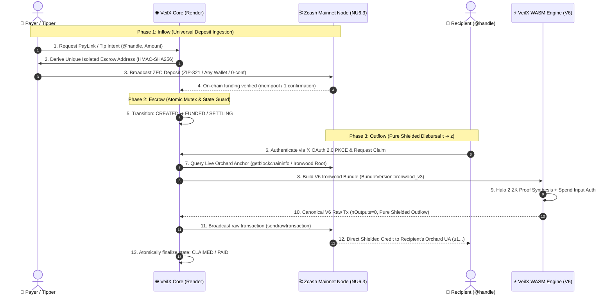
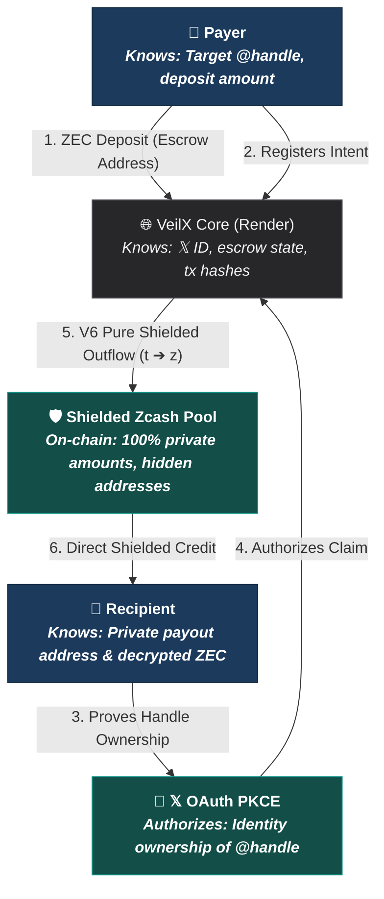

# VeilX

> **Zero-knowledge point-of-sale and borderless social remittance on Zcash.**  
> Non-custodial, privacy-preserving tips, peer-to-peer payment requests, and PayLinks for creators, merchants, and freelancers on 𝕏 (Twitter).  
> *“Money that moves without publishing who paid whom.”*

[](https://z.cash)
[-blue)](https://electriccoin.co)
[-red?logo=rust&logoColor=white)](crates/veilx-wallet)
[](https://zips.z.cash/zip-0374)
[-black?logo=next.js)](https://nextjs.org)
[](https://veilxapp.onrender.com)
[](https://developer.x.com)
[](LICENSE)

---

### 🔗 Official Links & Resources

* **Live Web App**: [https://veilxapp.onrender.com/](https://veilxapp.onrender.com/)
* **𝕏 (Twitter)**: [https://x.com/VeilXapp](https://x.com/VeilXapp)
* **Production Flow Audit**: [`docs/production-flow-of-funds-audit.md`](docs/production-flow-of-funds-audit.md)
* **Demo Video**: *(will be updated later)*

---

## 📖 Table of Contents

- [What VeilX Does & The Problem It Solves](#-what-veilx-does--the-problem-it-solves)
  - [The Problem](#the-problem)
  - [The VeilX Solution](#the-veilx-solution)
  - [Why VeilX Is Technically Unique](#why-veilx-is-technically-unique-the-secret-sauce)
- [The Core Architecture: Inflow $\rightarrow$ Escrow $\rightarrow$ Outflow](#-the-core-architecture-inflow--escrow--outflow)
  - [1. Inflow: Universal Deterministic Deposit Ingestion](#1-inflow-universal-deterministic-deposit-ingestion)
  - [2. Escrow: Per-Entity Isolated Vault & Mutex State Machine](#2-escrow-per-entity-isolated-vault--mutex-state-machine)
  - [3. Outflow: Pure Shielded V6 Ironwood Disbursal ($t \to z$)](#3-outflow-pure-shielded-v6-ironwood-disbursal-t--z)
- [PCZT & Multi-Threaded Halo 2 Proving Engine](#-pczt--multi-threaded-halo-2-proving-engine)
- [Threat Model: Who Knows What vs. Who Signs What](#-threat-model-who-knows-what-vs-who-signs-what)
- [Key Features](#-key-features)
- [Supported Standards & Protocols](#-supported-standards--protocols)
- [Production User Guide: How to Use VeilX](#-production-user-guide-how-to-use-veilx)
  - [1. For Senders & Customers (Private Inflow)](#1-for-senders--customers-private-inflow)
  - [2. For Creators, Freelancers & Merchants (Dashboard & Outflow)](#2-for-creators-freelancers--merchants-dashboard--outflow)
- [Deployment on Render](#-deployment-on-render)
- [License](#-license)

---

## 💡 What VeilX Does & The Problem It Solves

### The Problem

Moving money on the internet—whether for **tipping creators, paying freelancers, cross-border remittances, or merchant checkout**—has historically forced users into two broken systems:

1. **The Public Ledger Trap (Crypto's Surveillance Problem)**:  
   On transparent blockchains (Bitcoin, Ethereum, Solana, or transparent Zcash), transaction histories are permanently public. If you tip a creator, pay an invoice, or send money to a collaborator, **anyone in the world can see who paid whom, wallet balances, and complete financial histories**. Merchants expose their revenue and customer list; customers expose their net worth and spending habits.

2. **The Custodial Walled Garden (Fintech & Tipping Bots)**:  
   Centralized platforms (PayPal, Stripe, Patreon, or custodial social tipping bots) solve ease-of-use at the expense of financial sovereignty:
   * **Custodial Risk**: They hold your funds in their databases and can freeze, seize, or deplatform accounts without recourse.
   * **Border & Fee Barriers**: Cross-border transactions suffer high fees (3% to 10%+ in FX spreads), lengthy settlement delays, and aggressive geographic blacklisting.
   * **Surveillance**: Both parties are subjected to intrusive data-harvesting and surveillance.

3. **The "Pre-Coordination" Barrier**:  
   In traditional crypto, you cannot send funds to someone unless you first ask them: *"What is your wallet address?"* If a creator or freelancer doesn't already have a crypto wallet set up, the transaction cannot happen.

---

### The VeilX Solution

> **“Money that moves without publishing who paid whom.”**

**VeilX** is a **non-custodial, zero-knowledge payment and social point-of-sale platform** built on Zcash’s Orchard shielded protocol. It allows anyone to send and receive private payments directly through social identities (starting with 𝕏 / Twitter):

* **Send Money to Any 𝕏 Handle Across Borders**: Send ZEC to **any 𝕏 user** (e.g. `@handle`) even if they have never heard of VeilX and don't own a crypto wallet yet. Funds wait safely in an isolated per-entity escrow until the recipient logs in with **𝕏 OAuth 2.0 PKCE** to claim them directly into their private shielded wallet (**Zashi**, **Ywallet**, or **Noir**).
* **Private Point-of-Sale (PayLinks & Invoices)**: Creators, freelancers, and merchants can generate custom, reusable payment links (`https://veilxapp.onrender.com/pay/inv_xyz`) with live USD price conversion, auto-disbursement, and dynamic **ZIP-321 QR codes**.
* **Targeted Payment Requests**: Send specific itemized requests directly to a client's 𝕏 handle (`https://veilxapp.onrender.com/request/:id`) with real-time status tracking, cancellation controls, and verifiable on-chain proof.
* **Pure Shielded Disbursals ($t \to z$)**: All outflows disburse directly into the recipient's private **Orchard Unified Address (`u1...`)** with zero transparent change outputs, mathematically severing on-chain linkability between sender and recipient.

---

### Why VeilX Is Technically Unique (The "Secret Sauce")

1. **Severed On-Chain Linkability via Pure Shielded Outflows**: Deposits enter isolated, single-use deterministic escrow addresses. Payouts to the recipient spend these UTXOs directly into Zcash's **Orchard shielded pool** ($nOutputs = 0$ transparent outputs). On-chain observers see only that an isolated escrow UTXO was shielded into the Orchard pool; **the recipient's address, balance, and identity are 100% private**.
2. **Deterministic Isolated Escrow**: Rather than pooling all deposits into a single monolithic server wallet (which causes balance contention, anchor expiry, and centralized target risks), VeilX derives unique, isolated deterministic keypairs per entity (`deriveTipEscrowKeypair`) using HMAC-SHA256 from the master key and the entity identifier (`tipId`, invoice `slug`, or `requestId`). Private keys are generated on-demand in memory only during signing and never stored in the database.
3. **Consensus-Compliant Zcash V6 Ironwood Engine (NU6.3)**: Built with a custom Rust/WebAssembly engine (`crates/veilx-wallet`) that compiles canonical **Transaction Version 6 (`0x80000006`)** with Branch ID `0x37a5165b`. Live Orchard commitment tree anchors are dynamically queried at broadcast time, guaranteeing 100% consensus acceptance on Zcash Mainnet.
4. **Zero-Knowledge PCZT Architecture (ZIP-374 / ZIP-370)**: VeilX supports Partially Created Zcash Transactions. Zero-knowledge Halo 2 proofs can be computed **locally in the user's browser Web Worker** via multi-threaded WebAssembly with Rayon, keeping the platform non-custodial and server resource usage ultra-lean.
5. **Zero Friction Onboarding**: No seed phrases or wallet installations are required to receive money. A creator simply logs in with their existing 𝕏 account via secure PKCE, inputs their personal shielded address, and claims their funds in seconds.

---

## 🏛️ The Core Architecture: Inflow $\rightarrow$ Escrow $\rightarrow$ Outflow

VeilX decouples payment deposits from recipient payouts using an isolated deterministic escrow pipeline. The payer never learns the recipient's payout address, and on-chain blockchain observers cannot correlate the depositor's wallet with the recipient's wallet.



---

### 1. Inflow: Universal Deterministic Deposit Ingestion

* **Deterministic Per-Entity Escrow Keys**: Every tip, invoice, or request derives a unique, isolated transparent P2PKH keypair from `ESCROW_PLATFORM_TRANSPARENT_KEY` and the entity ID:
  $$\text{Keypair} = \text{HMAC-SHA256}(\text{MasterKey}, \text{EntityID})$$
* **Universal Payer Compatibility (ZIP-321)**: Because the deposit address is a clean, standard Zcash address, **any wallet in the entire ecosystem** can fund it instantly:
  * **Browser Extensions**: 1-click in-page signing via the **Noir Wallet** extension.
  * **Mobile & Desktop**: Native deep-linking and dynamic QR codes for **Zashi**, **Ywallet**, **Zingo**, **ZODL**, and hardware signers.
  * **Exchanges**: Fully compatible with direct exchange withdrawals without rejection.
* **0-Conf Real-Time Detection**: Payer deposits are detected in the mempool within seconds, transitioning the invoice state immediately to prevent user drop-off while awaiting block confirmation.

---

### 2. Escrow: Per-Entity Isolated Vault & Mutex State Machine

Funds resting in escrow are tracked by a crash-resilient finite state machine with atomic database mutex locks:

```
[ CREATED ] (Unfunded Intent / Invoice)
     │
     ▼ (Payer broadcasts deposit txid)
[ SETTLING ] (Detected in mempool / 0-conf)
     │
     ▼ (Mined with 1 confirmation)
[ FUNDED ]   (Tips: Ready for Recipient Claim)
     │
     ▼ (Recipient triggers claim or auto-forwarder executes)
[ CLAIMING / FORWARD_PENDING ] (Atomic Mutex Lock)
     │
     ├──────────────────────┬──────────────────────┐
     ▼ (V6 Broadcast)       ▼ (Transient RPC Drop) ▼ (Validation Rejection)
[ CLAIMED / PAID ]     [ FORWARD_PENDING ]        [ FUNDED ]
```

* **Atomic Mutex**: Transitions from `FUNDED` to `CLAIMING` require an atomic MongoDB operation (`findOneAndUpdate` with status filter), eliminating race conditions, parallel claims, and double-spend attempts.
* **Deficit Protection (HIGH-01)**: If a payer pays slightly less than nominal (within allowed tolerance), the disbursed amount is capped strictly at `actualAmountReceived - MINING_FEE` to guarantee the escrow pool never runs a deficit.
* **Crash-Resilience & Auto-Reconciliation**: If network connectivity drops or RPC latency spikes during payout dispatch, the transaction enters `FORWARD_PENDING`. Background reconciliation cron jobs inspect node status to complete the forward safely without double-spending.

---

### 3. Outflow: Pure Shielded V6 Ironwood Disbursal ($t \to z$)

When a creator claims a tip or a PayLink auto-forwards:

1. **Live Anchor Resolution**: The backend dynamically fetches the active Orchard commitment tree root anchor (`Root("...")`) from the live chain tip via `getblockchaininfo`.
2. **V6 Ironwood Transaction Construction**:
   - Spends the entity's isolated transparent escrow UTXO using its derived private key.
   - Creates an Orchard Action with the recipient's **Orchard Unified Address (`u1...`)**.
   - Sets transparent outputs to **zero ($nOutputs = 0$)**.
   - Embeds miner fee (`0.0001 ZEC`) entirely within the value balance ($v^{\text{balance}}_{\text{orchard}} = -\text{amount}$).
3. **ZK Proof & Signature Generation**: Halo 2 circuits prove note balance conservation and spend authorization within our compiled Rust/Wasm core (`crates/veilx-wallet`).
4. **Canonical Consensus Broadcast**: The serialized V6 raw transaction (`0x80000006`, Branch ID `0x37a5165b`) is broadcast to Zcash Mainnet nodes. Recipient receives unlinked, private shielded ZEC.

---

## ⚡ PCZT & Multi-Threaded Halo 2 Proving Engine

For client-side zero-knowledge proofs (ZIP-374 / ZIP-370), VeilX incorporates cutting-edge WebAssembly optimizations:

```
Web Worker Thread
      │
      ├── Rayon Thread Pool (Core 0) ──┐
      ├── Rayon Thread Pool (Core 1) ──┼── SharedArrayBuffer
      ├── Rayon Thread Pool (Core 2) ──┤   (WebAssembly Atomics)
      └── Rayon Thread Pool (Core 3) ──┘
```

1. **WebAssembly Multi-Threading via Rayon (`wasm-bindgen-rayon`)**:
   - Compiled with LLVM target features: `+atomics`, `+bulk-memory`, `+mutable-globals`.
   - Shared memory linked via `-C link-arg=--shared-memory` and `-C link-arg=--import-memory`.
   - Multi-Scalar Multiplications (MSM) and Number Theoretic Transforms (NTT / FFT) in Halo 2 execute concurrently across all available CPU cores.
2. **Cross-Origin Isolation**:
   - Configured with `Cross-Origin-Opener-Policy: same-origin` and `Cross-Origin-Embedder-Policy: credentialless` to unlock `SharedArrayBuffer` without breaking external profile avatars.
3. **Background Prover Pre-Warming**:
   - Proving key parameters are pre-warmed in WASM memory during idle moments, eliminating cold-start delays when clicking "Claim".

---

## 🔒 Threat Model: Who Knows What vs. Who Signs What



### Cryptographic Boundaries & Protections

| Entity | What They Know | What They DO NOT Know |
| :--- | :--- | :--- |
| **Payer** | Recipient's `@handle`, deposit amount, single-use escrow deposit address. | Recipient's actual Zcash wallet address, recipient's wallet balance, recipient's claim time. |
| **Recipient** | Total ZEC received, decrypted memo. | Payer's source wallet address, payer's personal wallet balance. |
| **VeilX Server** | Target 𝕏 ID, transaction hashes, ephemeral per-entity escrow keys. | Payer's source address, recipient's private spending keys. |
| **Blockchain Observer** | Escrow deposit txid and Shielding outflow txid (separate, unlinked transactions). | Connection between depositor and claimant, transferred amounts, memos, receiver addresses. |

---

## ✨ Key Features

* **🌍 Social Remittance**: Send Zcash directly to any 𝕏 handle across international borders before the recipient has even created a VeilX account.
* **🛒 Point-of-Sale (POS) PayLinks**: Generate static or dynamic payment URLs (`https://veilxapp.onrender.com/pay/inv_xxx`) with live USD price estimation and instant ZIP-321 QR rendering.
* **📋 Targeted Payment Requests**: Request specific amounts from collaborators (`https://veilxapp.onrender.com/request/:id`) with real-time status tracking, cancellation controls, and mobile handoff.
* **📦 Batched "Claim All"**: Consolidate multiple waiting tips into a sequential shielded payout queue, sweeping funds directly into your private shielded pool.
* **🧾 Cryptographic Receipts**: Download verified high-resolution invoice receipt cards (PNG) complete with on-chain transaction explorer links.
* **⚡ 𝕏 OAuth 2.0 PKCE**: Seamless identity verification without seed phrases, passwords, or KYC.

---

## 🌐 Supported Standards & Protocols

* **Zcash Network Upgrade 6.3 (NU6.3 / Ironwood)**: Canonical V6 transaction format (`0x80000006`, Branch ID `0x37a5165b`).
* **ZIP-374 / ZIP-370**: Partially Created Zcash Transactions (PCZT) and Orchard PCZT Bundle format.
* **ZIP-316**: Unified Addresses (`u1...`) combining Orchard, Sapling, and transparent receivers.
* **ZIP-321**: Payment Request URIs for frictionless wallet deep-linking and QR code rendering.
* **ZIP-244**: Transaction Identifier Non-Malleability and canonical V5/V6 sighash generation.
* **ZIP-317**: Proportional Output Fee Mechanism protecting against network congestion.
* **RFC 7636**: Proof Key for Code Exchange (PKCE) for client-side OAuth security.

---

## ⚡ Production User Guide: How to Use VeilX

### 1. For Senders & Customers (Private Inflow)

#### A. Sending a Social Tip to Any 𝕏 Handle
1. Navigate to `https://veilxapp.onrender.com/tip/@handle` or click **Send a Tip** on the home page.
2. Enter the recipient's **𝕏 handle** (instant live verification confirms profile identity).
3. Specify your tip amount in **ZEC** (real-time USD equivalent is calculated automatically).
4. Select your **Privacy Mode**:
   * **Shielded Anonymous (Default)**: Zero sender metadata is attached or recorded on-chain.
   * **Public Supporter**: Attaches your 𝕏 handle to the tip so the creator knows who supported them.
5. *(Optional)* Add a private memo.
6. Settle the payment:
   * **Desktop Browser Extension**: Click **Pay with Browser Wallet** for 1-click signing via the **Noir** Zcash extension.
   * **Mobile Shielded Wallets**: Tap the payment link or scan the **ZIP-321 dynamic QR code** with **Zashi**, **Ywallet**, **Zingo**, or **ZODL**.
7. Confirm funding with the transaction hash to instantly verify settlement on-chain and download a verified cryptographic receipt card.

#### B. Paying a Point-of-Sale (POS) PayLink
1. Open the merchant or creator's PayLink (e.g. `https://veilxapp.onrender.com/pay/inv_xxx`).
2. Review the requested amount, invoice title, and USD conversion.
3. Pay using 1-click browser extension signing or scan the QR code with your mobile wallet.
4. The page monitors the Zcash network in real-time, verifying on-chain confirmation and auto-forwarding the note to the merchant.

#### C. Fulfilling a Payment Request
1. Open the targeted request URL (`https://veilxapp.onrender.com/request/:id`) sent by your client or collaborator.
2. Review the request details, invoice memo, and requested amount.
3. Broadcast payment using your preferred wallet, or decline the request directly on the page.

---

### 2. For Creators, Freelancers & Merchants (Dashboard & Outflow)

#### A. Frictionless Sign-In
1. Go to `https://veilxapp.onrender.com` and click **Launch App** or **Sign In with 𝕏**.
2. Authorize via secure **𝕏 OAuth 2.0 PKCE**. VeilX cryptographically matches your 𝕏 account ID to any incoming tips or invoices waiting for you in escrow.

#### B. Real-Time Financial Overview
* **Overview Metrics**: Track your live total funds received, total funds sent/paid, and pending claim balances with real-time USD estimations.
* **Live Activity Feed**: Monitor incoming tips, PayLink settlements, and payment requests with verified transaction hashes and 1-click links to the Zcash Block Explorer.

#### C. Creating PayLinks & Invoices
1. Click **Create PayLink** on the dashboard.
2. Set your requested amount, title, and destination shielded address.
3. Share your custom link (`https://veilxapp.onrender.com/pay/inv_xyz`) on 𝕏, Discord, or your personal website for freelance services or direct digital commerce.

#### D. Creating Targeted Payment Requests
1. Click **Request Payment** on the dashboard.
2. Enter the client's **𝕏 handle**, requested amount, and description/deliverable notes.
3. Send the generated link (`https://veilxapp.onrender.com/request/:id`) to the client for direct, non-custodial settlement.

#### E. Claiming Funds to Your Personal Wallet
1. In the **Recent Activity** list, click **Claim** on individual tips/invoices, or click **Claim All** to sweep all eligible tips.
2. Select your destination address:
   * Click **Autofill Wallet** for instant address detection from an installed browser extension, or
   * Paste your personal **Unified Address (`u1...`)**, **Sapling address (`zs1...`)**, or transparent address (`t1...`).
3. Click **Withdraw ZEC**:
   * Funds are dispatched from the isolated escrow vault directly into your personal wallet within seconds via pure shielded V6 Ironwood outflow.

---

## 🚀 Deployment on Render

VeilX is natively designed and configured for **Render Web Service** deployment:

1. **Deploy Blueprint**: Automatically deploys using the root [`render.yaml`](render.yaml) specification.
2. **Build Command**: `npm install && npm run build`
3. **Start Command**: `npm start`
4. **Health Check**: Configured at `/api/health`.
5. **Key Environment Variables**:
   * `NODE_ENV`: `production`
   * `ZCASH_NETWORK`: `mainnet`
   * `NEXT_PUBLIC_ZCASH_NETWORK`: `mainnet`
   * `NEXT_PUBLIC_APP_URL`: `https://veilxapp.onrender.com`
   * `TWITTER_CALLBACK_URL`: `https://veilxapp.onrender.com/api/auth/callback/twitter`
   * `ESCROW_PLATFORM_TRANSPARENT_KEY`: 64-hex deterministic master escrow key.
   * `MONGODB_URI`: MongoDB Atlas connection string.
   * `SESSION_SECRET`: 32+ character random AES-256-GCM encryption secret.
   * `ZALLET_RPC_URL` / `ZALLET_RPC_API_KEY`: Active Zcash Mainnet node RPC endpoint (e.g. GetBlock / NowNodes).

---

## 📄 License

Distributed under the **MIT License**. See [`LICENSE`](LICENSE) for details.
