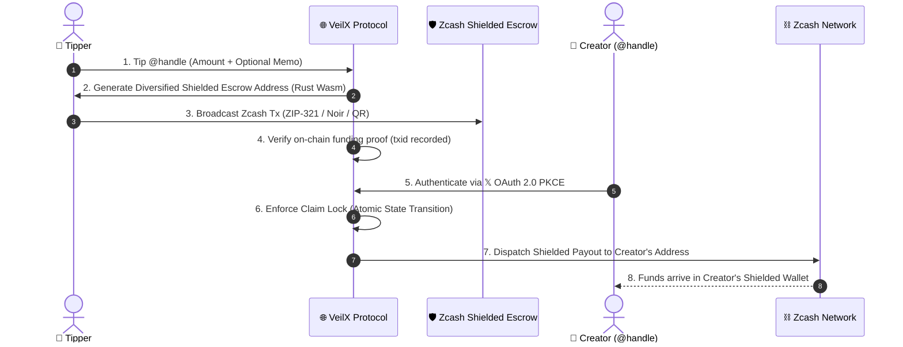
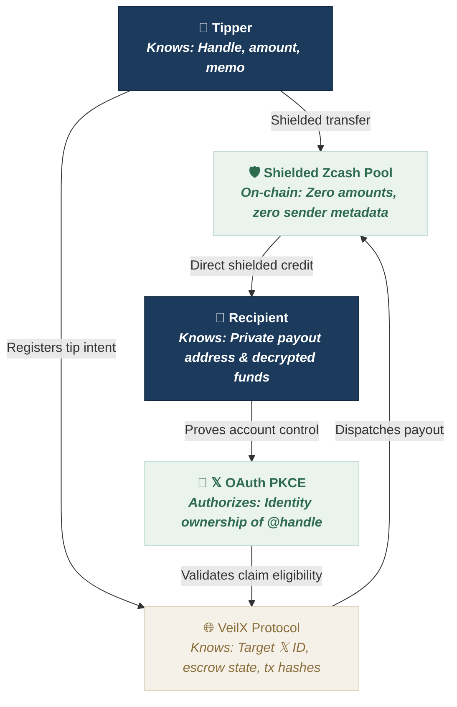

# VeilX

> **Private point-of-sale and borderless remittance for the social internet.**  
> Non-custodial, zero-knowledge Zcash tips, peer-to-peer payment requests, and PayLinks for creators, freelancers, and merchants on 𝕏 (Twitter).  
> *“Money that moves without publishing who paid whom.”*

[](https://z.cash)
[](https://electriccoin.co)
[](crates/veilx-wallet)
[](https://nextjs.org)
[](https://www.typescriptlang.org)
[](https://developer.x.com)
[](LICENSE)

---

## 💡 The Problem & The Architecture

Moving money on the internet—whether for **point-of-sale commerce, digital services, or borderless cross-border remittance**—has historically forced users into two broken tradeoffs:

1. **Public ledger exposure**: Transparent blockchain payments publish the full transaction graph forever. Every payment permanently links the customer to the merchant, or the sender to the recipient, revealing balances, revenue, and relationship histories.
2. **Custodial walled gardens**: Centralized payment processors and tipping bots hold user funds in custodial databases, surveil transactions, harvest financial metadata, and retain the power to freeze accounts.

**VeilX eliminates this tradeoff.**

VeilX provides a non-custodial financial layer where **money moves without publishing who paid whom**:
* **Borderless Social Remittance**: Send funds to **any 𝕏 handle** across borders before they have even signed up or downloaded a crypto wallet.
* **Private Point-of-Sale (POS)**: Merchants and creators generate instant, shareable PayLinks with dynamic ZIP-321 QR codes and live USD estimation.
* **Decoupled Settlement**: Payments flow into ephemeral shielded escrow pools backed by Zcash zero-knowledge proofs (zk-SNARKs / Halo2). When recipients authenticate via **𝕏 OAuth 2.0 (PKCE)**, payouts are dispatched directly into their self-custodial shielded wallets (Zashi, Ywallet, Zingo, or Noir browser extension) without leaving an on-chain paper trail linking payer to payee.



---

## 🔒 Threat Model: Who Knows What vs. Who Signs What

Designing a private social payment system requires being explicit about cryptographic boundaries rather than relying on generic trust claims.



### Cryptographic Guarantees:
* **Severed Linkability ("Who Paid Whom")**: By routing transactions through ephemeral diversified escrow addresses within the shielded pool, the on-chain graph between the payer and the final recipient is cryptographically unlinked. External blockchain observers cannot correlate who funded a payment with who received it.
* **The Tipper's Balance & History**: Hidden by Zcash zero-knowledge proofs (zk-SNARKs / Halo2).
* **The Escrow Pool**: Backed by Orchard and Sapling shielded pools with diversified addresses.
* **The Server Never Holds Creator Private Keys**: Payouts are dispatched directly to the recipient's self-custodial address (`u1...`, `zs1...`, or `t1...`).
* **Zero Race Conditions**: Tip claims execute under atomic database locks (`FUNDED` $\rightarrow$ `CLAIMING` $\rightarrow$ `CLAIMED`), preventing duplicate claims, concurrent payouts, and replay attacks.
* **On-Chain Auditability**: Every confirmed transaction records its on-chain hash (`fundingTxid`, `claimTxid`, `paidTxid`) with verifiable links to the Zcash Block Explorer.

---

## ✨ Features

* **🛒 Private Point-of-Sale (PayLinks & Invoices)**: Generate custom private payment links (e.g. `veilx.cash/pay/inv_xxx`) with live USD conversions, dynamic ZIP-321 QR codes, and on-chain settlement verification for freelance work, digital services, and creator commerce.
* **🌍 Borderless Social Remittance**: Send privacy-preserving Zcash directly to any 𝕏 handle across borders before the recipient has even joined the platform, with zero on-chain linkability between sender and recipient.
* **📦 Bulk Claiming Engine (`Claim All`)**: Claim all accumulated tips in a single batched shielded transaction, saving up to 90% in network fees while consolidating funds directly to your wallet.
* **📋 Targeted Payment Requests**: Create explicit payment requests (`veilx.cash/request/:id`) targeting specific 𝕏 collaborators or clients, complete with mobile payer handoff, proof submission, and bidirectional decline/cancellation.
* **🧾 Downloadable Payment Receipt Cards**: Generate and download high-resolution (1200×760 PNG) verified invoice cards upon successful settlement for your records or clients.
* **⚡ Smart Account Suggestions**: Instant client-side persistence of recently searched 𝕏 accounts with live auto-lookup, eliminating mock suggestions.
* **🔌 Universal Zcash Wallet Support**:
  * **Desktop Browser Extensions**: 1-click extension signing compatible with all Zcash browser wallets (Noir, Keystop, Web3 Zcash).
  * **Mobile & Desktop Wallets**: Standard **ZIP-321** payment URIs and dynamic QR codes compatible with all Zcash shielded wallets (**Zashi**, **Ywallet**, **Zingo**, **ZODL**, and more).
* **⚡ 𝕏 OAuth 2.0 PKCE Login**: Frictionless recipient authentication with no seed phrases or password setup required for creators and freelancers to claim funds.
* **📨 Encrypted Memos**: Attach private encrypted notes delivered along with the Zcash shielded transaction.
* **📈 Live ZEC Price Engine**: Real-time CoinGecko price polling with 24-hour delta tracking and instant USD conversion.
* **🔍 On-Chain Proof Explorer**: 1-click copy and direct links to the block explorer for all confirmed transactions (`fundingTxid`, `claimTxid`, `paidTxid`).
* **🌉 Cross-Chain EVM Gateway**: Architecture prepared for multi-chain liquidity (Base, Arbitrum, Ethereum to ZEC via intent solvers; coming soon on mainnet).

---

## 🛠️ Tech Stack

* **Frontend**: Next.js 14 (App Router), React 18, Tailwind CSS, Lucide Icons, Framer Motion
* **Native Rust WebAssembly Core (`crates/veilx-wallet`)**:
  * ZIP-316 Bech32m Unified Address encoding/decoding (`zcash_address`)
  * Unified Full Viewing Key (UFVK `uview1...`) registration & tree scanning
  * Client/Server high-performance cryptographic primitives compiled via `wasm-pack`
* **Cryptography & SDKs**: `@noir-wallet/sdk`, `@noble/curves`, `@noble/hashes`, Base58Check, Bech32 / Bech32m checksum validation
* **Backend & API**: Next.js Server Components, Route Handlers, MongoDB (Mongoose) with memory fallback
* **Authentication**: 𝕏 OAuth 2.0 with PKCE (RFC 7636) & iron-session AES-256 encrypted cookies
* **Zcash Node Connectivity**: High-availability Mainnet RPC integration for live Orchard anchors and transaction broadcasting

---

## ⚡ Getting Started — How to Use VeilX

VeilX is designed to be frictionless: **no seed phrases to write down and no complex wallet setup to receive funds**. Anyone can tip or claim in less than two minutes.

### 1. Launch the App & Sign in with 𝕏
1. Go to the VeilX Web App (`veilx.cash` or your deployment URL).
2. Click **Launch App** or **Sign In with 𝕏**.
3. Authorize with your **𝕏 account** via secure **OAuth 2.0 PKCE**. VeilX cryptographically matches your 𝕏 handle (`@yourhandle`) with any tips waiting in the shielded escrow pool.

---

### 2. Sending a Private Tip or Borderless Remittance
1. Click **Send a Tip** from the dashboard or navigate directly to `veilx.cash/tip/username`.
2. Enter the recipient's **𝕏 handle** (instant live lookup verifies profile identity).
3. Enter your tip amount in **ZEC** (real-time USD conversions are calculated automatically).
4. Choose your privacy mode:
   * **Shielded Anonymous (Default)**: Zero sender metadata is recorded.
   * **Public Supporter**: Attaches your 𝕏 handle so the creator knows who tipped them.
5. *(Optional)* Add a private encrypted memo.
6. Settle the generated escrow payment:
   * **Browser Extension**: Click **Pay with Browser Wallet** for instant 1-click extension signing.
   * **Mobile Shielded Wallets**: Scan the **ZIP-321 QR code** or tap the link with any Zcash wallet (**Zashi**, **Ywallet**, **Zingo**, **ZODL**, etc.).
7. Confirm funding with the transaction hash to record verifiable on-chain proof and download your receipt card.

---

### 3. Claiming Your Waiting Funds
1. Once someone sends funds to your 𝕏 handle, sign into your VeilX dashboard.
2. In the **Recent Activity** list, click **Claim** on individual tips, or click **Claim All** to claim multiple tips in one single batch transaction.
3. Choose your destination address:
   * Click **Autofill Wallet** to automatically pull your address from an installed browser extension, or
   * Paste your personal **Unified Address (`u1...`)**, **Sapling address (`zs1...`)**, or transparent address (`t1...`) from your mobile wallet.
4. Click **Withdraw ZEC**. Funds are dispatched directly from the escrow pool into your personal wallet within seconds.

---

### 4. Point-of-Sale (POS) PayLinks & Invoices
1. Click **Create PayLink** on the dashboard.
2. Set your requested amount, title, and destination shielded address.
3. Share your custom link (e.g. `veilx.cash/pay/inv_xyz`) on 𝕏, Discord, or your personal website for freelancing, services, or direct merchant checkout.
4. Once paid, both you and the customer can download an official cryptographic receipt.

---

## 🌐 Supported Protocols & Standards

VeilX is engineered in strict compliance with official Zcash protocol improvement proposals and cryptography standards:

* **ZIP-316 (Unified Addresses)**: Seamless routing across Orchard shielded, Sapling shielded, and transparent receivers within a single Bech32m address format (`u1...`).
* **ZIP-321 (Payment Request URIs)**: Standardized deep-linking and dynamic QR code generation for universal mobile and desktop wallet compatibility.
* **ZIP-244 (Transaction Identifier Non-Malleability)**: v5 transaction structure and non-malleable signature hashing for trustless on-chain proofs.
* **ZIP-317 (Proportional Output Fee Mechanism)**: Dynamic, fair transaction fee calculation preventing mempool congestion and ensuring fast block confirmation.
* **RFC 7636 (PKCE OAuth 2.0)**: Proof Key for Code Exchange protocol eliminating client secret exposure and securely linking 𝕏 identities to recipient claims.
* **Halo2 / zk-SNARKs**: Zero-knowledge proof verification ensuring end-to-end sender and receiver confidentiality.

---

## 📡 API Reference

### Tips & Outflow Claims

| Endpoint | Method | Description |
| :--- | :--- | :--- |
| `/api/tips` | `GET` | List confirmed tips for the authenticated user |
| `/api/tips` | `POST` | Create a new tip intent to an 𝕏 handle |
| `/api/tips/:id/fund` | `POST` | Record on-chain funding transaction hash (`fundingTxid`) |
| `/api/tips/:id/claim` | `POST` | Claim an individual tip to a shielded address (Requires 𝕏 auth) |
| `/api/tips/claim-all` | `POST` | Atomically claim all eligible tips in a single batched payout |

### Payment Requests & PayLinks

| Endpoint | Method | Description |
| :--- | :--- | :--- |
| `/api/requests` | `GET` | Fetch incoming/outgoing payment requests for user |
| `/api/requests` | `POST` | Create a targeted payment request to an 𝕏 handle |
| `/api/requests/:id/settle` | `POST` | Record on-chain payment proof for a request |
| `/api/requests/:id/reject` | `POST` | Decline incoming request or cancel outgoing request |
| `/api/paylinks` | `GET` | List active PayLinks for authenticated creator |
| `/api/paylinks` | `POST` | Generate a shareable PayLink invoice (`inv_xxx`) |
| `/api/paylinks/:slug` | `GET` | Retrieve invoice details and active status |
| `/api/paylinks/:slug/settle`| `POST` | Settle a PayLink with verified transaction hash |

### System & Oracle

| Endpoint | Method | Description |
| :--- | :--- | :--- |
| `/api/health` | `GET` | System health, Zcash node connectivity, and circuit breaker status |
| `/api/prices` | `GET` | Live ZEC/USD price quote with 24-hour delta |
| `/api/cron/reconcile` | `GET` | Reconcile pending intermediate transactions against on-chain status |

---

## 🔐 Security & Concurrency Safety

VeilX uses a strict finite state machine for financial transactions:

```
[ CREATED ] (Unfunded Intent)
     │
     ▼ (Tipper broadcasts fundingTxid)
[ FUNDED ]  (Confirmed in Shielded Pool)
     │
     ▼ (Creator initiates claim with authenticated 𝕏 ID)
[ CLAIMING ] (Atomic Mutex Lock)
     │
     ├──────────────┬──────────────┐
     ▼ (Success)    ▼ (Timeout)    ▼ (Node Error)
[ CLAIMED ]    [ PENDING_VERIFICATION ]   [ FUNDED ]
```

* **Atomic Claim Lock**: Prevents duplicate payouts by ensuring only one claim request can transition a tip from `FUNDED` to `CLAIMING`.
* **Crash-Safe Intermediates**: Network drops or RPC latency transition tips to `PENDING_VERIFICATION` with durable operation IDs (`payoutOpid`), preventing double payouts while allowing deterministic status reconciliation.
* **Cryptographic Address Sanitization**: Every address is validated using Base58Check (transparent) and Bech32/Bech32m (Sapling & Orchard Unified Addresses) before any transaction is constructed.
* **Circuit Breakers**: Payout dispatch routes include automated threshold guards and circuit breaker triggers to protect funds against RPC anomalies.

---

## 📄 License

Distributed under the **MIT License**. See `LICENSE` for more details.
