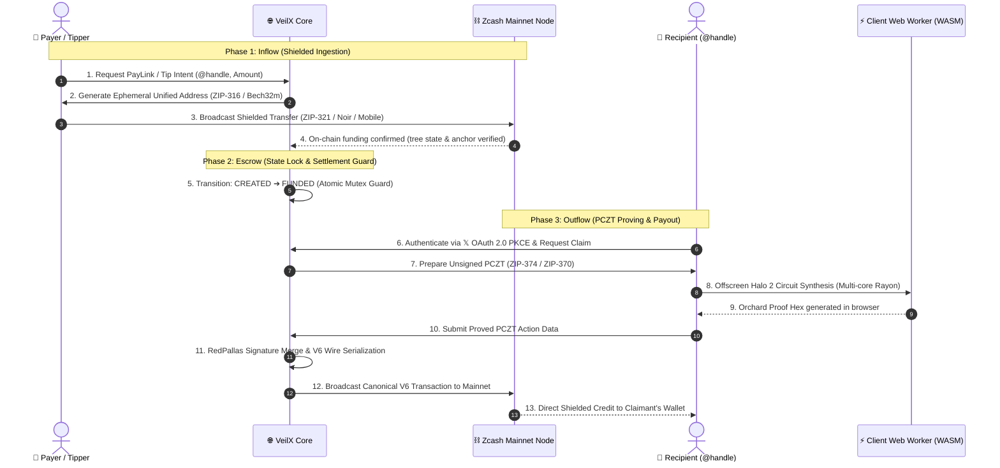
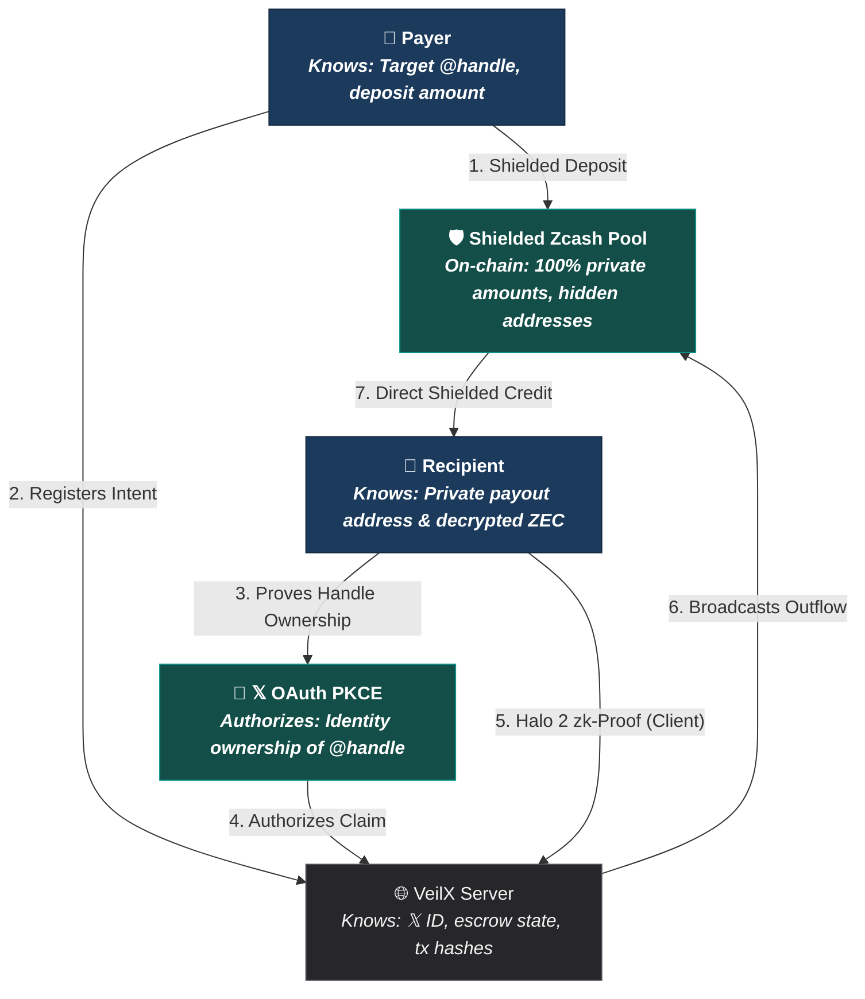

# VeilX

> **Zero-knowledge point-of-sale and borderless social remittance on Zcash.**  
> Non-custodial, privacy-preserving tips, peer-to-peer payment requests, and PayLinks for creators, merchants, and freelancers on 𝕏 (Twitter).  
> *“Money that moves without publishing who paid whom.”*

[](https://z.cash)
[](https://electriccoin.co)
[-red?logo=rust&logoColor=white)](crates/veilx-wallet)
[](https://zips.z.cash/zip-0374)
[-black?logo=next.js)](https://nextjs.org)
[](https://www.typescriptlang.org)
[](https://developer.x.com)
[](LICENSE)

---

### 🔗 Official Links & Resources

* **Live Web App**: [https://veilxapp.vercel.app/](https://veilxapp.vercel.app/)
* **𝕏 (Twitter)**: [https://x.com/VeilXapp](https://x.com/VeilXapp)
* **Demo Video**: *(will be updated later)*

---

## 📖 Table of Contents

- [What VeilX Does & The Problem It Solves](#-what-veilx-does--the-problem-it-solves)
  - [The Problem](#the-problem)
  - [The VeilX Solution](#the-veilx-solution)
  - [Why VeilX Is Technically Unique](#why-veilx-is-technically-unique-the-secret-sauce)
- [The Core Architecture: Inflow $\rightarrow$ Escrow $\rightarrow$ Outflow](#-the-core-architecture-inflow--escrow--outflow)
  - [1. Inflow: Ephemeral Shielded Ingestion](#1-inflow-ephemeral-shielded-ingestion)
  - [2. Escrow: Shielded State Machine & Mutex Locks](#2-escrow-shielded-state-machine--mutex-locks)
  - [3. Outflow: Client-Side PCZT Proving & Finalization](#3-outflow-client-side-pczt-proving--finalization)
- [PCZT & Multi-Threaded Halo 2 Proving](#-pczt--multi-threaded-halo-2-proving)
- [Threat Model: Who Knows What vs. Who Signs What](#-threat-model-who-knows-what-vs-who-signs-what)
- [Key Features](#-key-features)
- [Supported Standards & Protocols](#-supported-standards--protocols)
- [Production User Guide: How to Use VeilX](#-production-user-guide-how-to-use-veilx)
  - [1. For Senders & Customers (Private Inflow)](#1-for-senders--customers-private-inflow)
  - [2. For Creators, Freelancers & Merchants (Dashboard & Outflow)](#2-for-creators-freelancers--merchants-dashboard--outflow)
- [License](#-license)

---

## 💡 What VeilX Does & The Problem It Solves

### The Problem

Moving money on the internet—whether for **tipping creators, paying freelancers, cross-border remittances, or merchant checkout**—has historically forced users into two broken systems:

1. **The Public Ledger Trap (Crypto's Surveillance Problem)**:  
   On transparent blockchains (Bitcoin, Ethereum, Solana, or transparent Zcash), the transaction history is public forever. If you tip a creator, pay an invoice, or send money to a collaborator, **anyone in the world can see who paid whom, wallet balances, and complete financial histories**. Merchants expose their revenue and customer list; customers expose their net worth and spending habits.

2. **The Custodial Walled Garden (Fintech & Tipping Bots)**:  
   Centralized platforms (PayPal, Stripe, Patreon, or custodial social tipping bots) solve ease-of-use at the expense of financial sovereignty:
   * **Custodial Risk**: They hold your funds in their databases and can freeze, seize, or deplatform accounts without recourse.
   * **Border & Fee Barriers**: Cross-border transactions suffer high fees (3% to 10%+ in FX spreads), lengthy settlement delays, and aggressive geographic blacklisting.
   * **Surveillance**: Both parties are subjected to intrusive data-harvesting and surveillance.

3. **The "Pre-Coordination" Barrier**:  
   In traditional crypto, you cannot send funds to someone unless you first ask them: *"What is your wallet address?"* If a creator or freelancer doesn't already have a crypto wallet set up, the transaction cannot happen.

---

### The VeilX Solution

> **“Money that moves without publishing who paid whom.”**

**VeilX** is a **non-custodial, zero-knowledge payment and social point-of-sale platform** built on Zcash’s Orchard shielded protocol. It allows anyone to send and receive private payments directly through social identities (starting with 𝕏 / Twitter):

* **Send Money to Any 𝕏 Handle Across Borders**: Send private ZEC to **any 𝕏 user** (e.g. `@handle`) even if they have never heard of VeilX and don't own a crypto wallet yet. Funds wait safely in an ephemeral shielded escrow until the recipient logs in with **𝕏 OAuth 2.0 PKCE** to claim them directly into their personal wallet (**Zashi**, **Ywallet**, or **Noir**).
* **Private Point-of-Sale (PayLinks & Invoices)**: Creators, freelancers, and merchants can generate custom, reusable payment links (`veilx.cash/pay/inv_xyz`) with live USD price conversion and dynamic **ZIP-321 QR codes**.
* **Targeted Payment Requests**: Send specific itemized requests directly to a client's 𝕏 handle (`veilx.cash/request/:id`) with real-time status tracking, cancellation controls, and verifiable on-chain proof.
* **Batched "Claim All" Payouts**: Creators with multiple incoming tips can sweep them into their personal wallet in a single batched transaction, saving up to 90% on network fees.

---

### Why VeilX Is Technically Unique (The "Secret Sauce")

1. **Severed On-Chain Linkability**: Deposits flow into ephemeral diversified addresses inside Zcash's Orchard shielded pool. Payouts to the recipient are separate, uncorrelated transactions. On-chain observers see that funds entered the shielded pool and funds left the shielded pool, but **it is mathematically impossible to link who paid whom**.
2. **Zero-Knowledge PCZT Architecture (ZIP-374 / ZIP-370)**: VeilX uses Partially Created Zcash Transactions. The heavy zero-knowledge Halo 2 proofs are computed **locally in the user's browser Web Worker** via multi-threaded WebAssembly. The platform never holds the creator's private keys, and the server never needs gigabytes of RAM to prove transactions.
3. **Zero Friction Onboarding**: No seed phrases or wallet installations are required to receive money. A creator simply logs in with their existing 𝕏 account via secure PKCE, pastes their wallet address (or autofills from an extension), and withdraws their funds in seconds.

---

## 🏛️ The Core Architecture: Inflow $\rightarrow$ Escrow $\rightarrow$ Outflow

VeilX decouples payment deposits from recipient payouts using an ephemeral shielded escrow pipeline. The payer never learns the recipient's payout address, and on-chain blockchain observers cannot correlate the depositor's wallet with the recipient's wallet.



---

### 1. Inflow: Ephemeral Shielded Ingestion

* **Ephemeral Unified Addresses (ZIP-316)**: Every tip, invoice, or request instantiates a unique, isolated diversified payment address. Deposits flow into dedicated shielded note commitments rather than a single pooled address, preventing external clustering.
* **Universal Payer Compatibility (ZIP-321)**: The client generates standardized payment URIs and dynamic QR codes compatible with all major Zcash wallets:
  * **Browser Extensions**: 1-click in-page signing via the Noir Wallet extension.
  * **Mobile & Desktop**: Native deep-linking for **Zashi**, **Ywallet**, **Zingo**, **ZODL**, and hardware signers.
* **Anchor & Tree Verification**: Inflow transactions are tracked through the Zcash node's Orchard commitment tree. The server verifies block height, confirmations, and tree root anchors before validating note ownership.

---

### 2. Escrow: Shielded State Machine & Mutex Locks

Funds resting in escrow are tracked by a crash-resilient finite state machine:

```
[ CREATED ] (Unfunded Intent / Invoice)
     │
     ▼ (Payer broadcasts deposit txid)
[ FUNDED ]  (Confirmed in Orchard Shielded Pool)
     │
     ▼ (Recipient initiates claim with verified 𝕏 OAuth token)
[ CLAIMING ] (Atomic Mutex Lock)
     │
     ├──────────────────────┬──────────────────────┐
     ▼ (Proof + Broadcast)  ▼ (Network Timeout)    ▼ (Validation Error)
[ CLAIMED ]            [ PENDING_VERIFICATION ]   [ FUNDED ]
```

* **Atomic Mutex**: Transitions from `FUNDED` to `CLAIMING` require an atomic database operation, eliminating race conditions, parallel claims, and double-spend attempts.
* **Crash-Resilience (`PENDING_VERIFICATION`)**: If network connectivity drops or RPC latency spikes during payout dispatch, the transaction retains a persistent Operation ID (`payoutOpid`). Background cron reconciliation inspects the mempool and node state to settle or release the claim lock safely without human intervention.
* **Zero Custodial Hold**: Escrow keys are ephemeral and strictly governed by automated cryptographic settlement logic.

---

### 3. Outflow: Client-Side PCZT Proving & Finalization

Instead of requiring the server to bear the CPU and memory burden of generating zero-knowledge proofs (which crashes standard 512MB–1GB server environments like Vercel or Render), VeilX implements a **hybrid client-server PCZT protocol**:

1. **PCZT Preparation (Server)**:
   - Queries the on-chain Orchard anchor.
   - Extracts note commitment data (nullifier, value, diversified transmission key `pk_d`, and rho).
   - Generates the recipient's output action with encrypted ciphertext and memo.
   - Computes the canonical **ZIP-244 V6 Transaction Sighash**.
   - Calculates the **RedPallas** spend authorization signature using the escrow spending key.
   - Packages the unsigned transaction into an Orchard PCZT payload.

2. **Offscreen Proving (Client Web Worker)**:
   - The user's browser receives the PCZT parameters and delegates computation to a dedicated Web Worker (`pczt-prover.worker.js`).
   - The worker executes our high-performance Rust WebAssembly core (`crates/veilx-wallet`).
   - Halo 2 synthesizes the Orchard circuit, calculates note balance equality, and generates the cryptographic zk-SNARK proof.
   - The main UI thread remains completely unblocked at 60 FPS.

3. **Wire Serialization & Broadcast (Server)**:
   - The browser sends the proof and action commitments back to the API.
   - The server verifies the sighash match and merges the client's Halo 2 proof with the server's RedPallas spend signature.
   - The canonical V6 raw transaction is constructed according to Zcash Network Upgrade 6 specifications and broadcast to Mainnet.

---

## ⚡ PCZT & Multi-Threaded Halo 2 Proving

Traditional browser-based Halo 2 proofs are notoriously heavy, taking 3 to 5+ minutes when executed sequentially on a single thread. VeilX incorporates cutting-edge optimizations to achieve **sub-minute desktop proof times**:

```
Web Worker Thread
      │
      ├── Rayon Thread Pool (Core 0) ──┐
      ├── Rayon Thread Pool (Core 1) ──┼── SharedArrayBuffer
      ├── Rayon Thread Pool (Core 2) ──┤   (WebAssembly Atomics)
      └── Rayon Thread Pool (Core 3) ──┘
```

1. **WebAssembly Multi-Threading via Rayon (`wasm-bindgen-rayon`)**:
   - Compiled with LLVM target features: `+atomics`, `+bulk-memory`, `+mutable-globals`.
   - Shared memory linked via `-C link-arg=--shared-memory` and `-C link-arg=--import-memory`.
   - Multi-Scalar Multiplications (MSM) and Number Theoretic Transforms (NTT / FFT) in Halo 2 execute concurrently across all available CPU cores.

2. **Cross-Origin Isolation**:
   - Next.js is configured with HTTP headers:
     ```http
     Cross-Origin-Opener-Policy: same-origin
     Cross-Origin-Embedder-Policy: credentialless
     ```
   - Unlocks `SharedArrayBuffer` for WebAssembly threads while maintaining full compatibility with external profile images and media.

3. **Background Prover Pre-Warming**:
   - The large `ORCHARD_PROVING_KEY` parameter set is synthesized into WASM memory in the background during idle moments (such as dashboard load or when opening a modal).
   - By the time the user clicks "Claim", circuit parameter generation is already complete, eliminating initial cold-start delay.

4. **Persistent Worker Lifecycle**:
   - The proving worker stays alive across multiple claims, retaining cached verification parameters for subsequent claims and batched "Claim All" operations.

---

## 🔒 Threat Model: Who Knows What vs. Who Signs What



### Cryptographic Boundaries & Protections

| Entity | What They Know | What They DO NOT Know |
| :--- | :--- | :--- |
| **Payer** | Recipient's `@handle`, deposit amount, ephemeral deposit address. | Recipient's actual Zcash wallet address, recipient's wallet balance, recipient's claim time. |
| **Recipient** | Total ZEC received, decrypted memo. | Payer's source wallet address, payer's personal wallet balance. |
| **VeilX Server** | Target 𝕏 ID, transaction hashes, ephemeral escrow keys. | Payer's source address, recipient's private spending keys. |
| **Blockchain Observer** | Inflow txid and Outflow txid (separate, uncorrelated transactions). | Connection between depositor and claimant, transferred amounts, memos, receiver addresses. |

---

## ✨ Key Features

* **🌍 Social Remittance**: Send Zcash directly to any 𝕏 handle across international borders before the recipient has even created a VeilX account.
* **🛒 Point-of-Sale (POS) PayLinks**: Generate static or dynamic payment URLs (`veilx.cash/pay/inv_xxx`) with live USD price estimation and instant ZIP-321 QR rendering.
* **📋 Targeted Payment Requests**: Request specific amounts from collaborators (`veilx.cash/request/:id`) with real-time status tracking, cancellation controls, and mobile handoff.
* **📦 Batched "Claim All"**: Consolidate multiple waiting tips into a single batched shielded payout, saving up to 90% in transaction fees.
* **🧾 Cryptographic Receipts**: Download verified high-resolution invoice receipt cards (PNG) complete with on-chain transaction explorer links.
* **⚡ 𝕏 OAuth 2.0 PKCE**: Seamless identity verification without seed phrases, passwords, or KYC.

---

## 🌐 Supported Standards & Protocols

* **ZIP-374 / ZIP-370**: Partially Created Zcash Transactions (PCZT) and Orchard PCZT Bundle format.
* **ZIP-316**: Unified Addresses (`u1...`) combining Orchard, Sapling, and transparent receivers.
* **ZIP-321**: Payment Request URIs for frictionless wallet deep-linking and QR code rendering.
* **ZIP-244**: Transaction Identifier Non-Malleability and canonical V5/V6 sighash generation.
* **ZIP-317**: Proportional Output Fee Mechanism protecting against network congestion.
* **RFC 9591 / ZIP-312**: Foundation architecture prepared for FROST threshold RedPallas signatures.
* **RFC 7636**: Proof Key for Code Exchange (PKCE) for client-side OAuth security.

---

## ⚡ Production User Guide: How to Use VeilX

VeilX is engineered for seamless production use on the social internet. There are no seed phrases to write down and no complex setup requirements to receive or send funds.

---

### 1. For Senders & Customers (Private Inflow)

#### A. Sending a Social Tip to Any 𝕏 Handle
1. Navigate to `veilx.cash/tip/@handle` or click **Send a Tip** on the home page.
2. Enter the recipient's **𝕏 handle** (instant live verification confirms profile identity).
3. Specify your tip amount in **ZEC** (real-time USD equivalent is calculated automatically).
4. Select your **Privacy Mode**:
   * **Shielded Anonymous (Default)**: Zero sender metadata is attached or recorded on-chain.
   * **Public Supporter**: Attaches your 𝕏 handle to the tip so the creator knows who supported them.
5. *(Optional)* Add a private encrypted memo.
6. Settle the payment:
   * **Desktop Browser Extension**: Click **Pay with Browser Wallet** for 1-click signing via the **Noir** Zcash extension.
   * **Mobile Shielded Wallets**: Tap the payment link or scan the **ZIP-321 dynamic QR code** with **Zashi**, **Ywallet**, **Zingo**, or **ZODL**.
7. Confirm funding with the transaction hash to instantly verify settlement on-chain and download a verified cryptographic receipt card.

#### B. Paying a Point-of-Sale (POS) PayLink
1. Open the merchant or creator's PayLink (e.g. `veilx.cash/pay/inv_xxx`).
2. Review the requested amount, invoice title, and USD conversion.
3. Pay using 1-click browser extension signing or scan the QR code with your mobile wallet.
4. The page monitors the Zcash network in real-time, verifying on-chain confirmation and auto-forwarding the note to the merchant.

#### C. Fulfilling a Payment Request
1. Open the targeted request URL (`veilx.cash/request/:id`) sent by your client or collaborator.
2. Review the request details, invoice memo, and requested amount.
3. Broadcast payment using your preferred wallet, or decline the request directly on the page.

---

### 2. For Creators, Freelancers & Merchants (Dashboard & Outflow)

#### A. Frictionless Sign-In
1. Go to `veilx.cash` and click **Launch App** or **Sign In with 𝕏**.
2. Authorize via secure **𝕏 OAuth 2.0 PKCE**. VeilX cryptographically matches your 𝕏 account ID to any incoming tips or invoices waiting for you in the shielded escrow pool.

#### B. Real-Time Financial Overview
* **Overview Metrics**: Track your live total funds received, total funds sent/paid, and pending claim balances with real-time USD estimations.
* **Live Activity Feed**: Monitor incoming tips, PayLink settlements, and payment requests with verified transaction hashes and 1-click links to the Zcash Block Explorer.

#### C. Creating PayLinks & Invoices
1. Click **Create PayLink** on the dashboard.
2. Set your requested amount, title, and destination shielded address.
3. Share your custom link (`veilx.cash/pay/inv_xyz`) on 𝕏, Discord, or your personal website for freelance services or direct digital commerce.

#### D. Creating Targeted Payment Requests
1. Click **Request Payment** on the dashboard.
2. Enter the client's **𝕏 handle**, requested amount, and description/deliverable notes.
3. Send the generated link (`veilx.cash/request/:id`) to the client for direct, non-custodial settlement.

#### E. Claiming Funds to Your Personal Wallet
1. In the **Recent Activity** list, click **Claim** on individual tips/invoices, or click **Claim All** to sweep all eligible tips in a single batched shielded transaction.
2. Select your destination address:
   * Click **Autofill Wallet** for instant address detection from an installed browser extension, or
   * Paste your personal **Unified Address (`u1...`)**, **Sapling address (`zs1...`)**, or transparent address (`t1...`).
3. Click **Withdraw ZEC**:
   * The browser Web Worker executes the multi-threaded Halo 2 prover locally in the background (pre-warmed during idle time).
   * Funds are dispatched from the escrow pool directly into your personal wallet within seconds.

---

## 📄 License

Distributed under the **MIT License**. See [`LICENSE`](LICENSE) for details.
